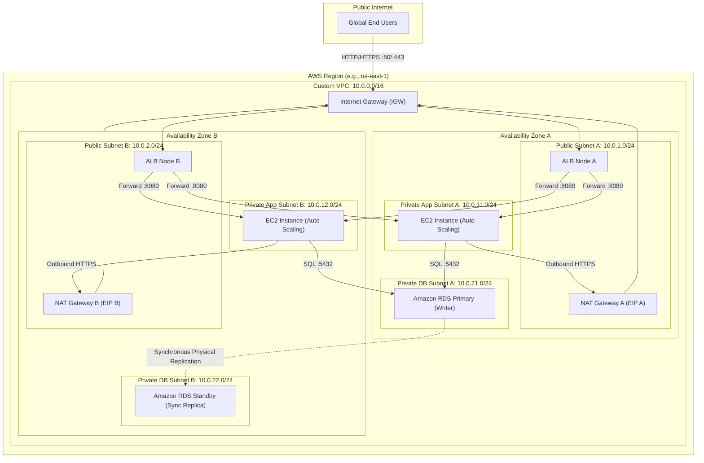

# Production-Grade Highly Available 3-Tier AWS Architecture Using Terraform

[](https://www.terraform.io/)
[](https://registry.terraform.io/providers/hashicorp/aws/latest)
[](https://www.checkov.io/)
[](#target-architecture)

A production-grade, highly available, secure 3-tier web application infrastructure on AWS provisioned entirely with modular Terraform. Built according to the **AWS Well-Architected Framework** and strict zero-trust security principles.

---

## Target Architecture



---

## Key Architectural Principles

1. **Defense-in-Depth & Zero-Trust Chaining**:
   - Compute instances have **strictly zero public IPs**.
   - Security groups reference upstream IDs directly (ALB SG $\rightarrow$ EC2 SG $\rightarrow$ RDS SG) rather than wide subnet CIDR blocks.
   - Database subnets are completely air-gapped: no route to Internet Gateways and no route to NAT Gateways.
2. **Modern IAM & Elimination of Bastion Hosts**:
   - AWS Systems Manager (SSM) Session Manager replaces SSH jump boxes and key pairs. Inbound port 22 is completely closed.
   - IMDSv2 is strictly enforced (`http_tokens = "required"` with hop limit 1) to eliminate SSRF attack vectors.
3. **Secrets Management**:
   - Database master passwords are generated cryptographically and injected directly into **AWS Secrets Manager**. No passwords in code, `.tfvars`, or CLI logs.
4. **Resilience & High Availability**:
   - Multi-AZ across 2 Availability Zones.
   - Dual NAT Gateways in production to eliminate cross-AZ failure dependencies.
   - Amazon RDS Multi-AZ with synchronous physical replication for zero data loss (RPO = 0).
   - Auto Scaling Group with `health_check_type = "ELB"` and target tracking scaling at 70% CPU.

---

## AWS Services Used

* **VPC & Networking**: Custom VPC, 6 Subnets, Internet Gateway, Multi-AZ NAT Gateways, Route Tables.
* **Compute**: EC2 Launch Templates (Amazon Linux 2023), Auto Scaling Groups.
* **Load Balancing**: Application Load Balancer (ALB), Target Groups, Listeners.
* **Database**: Amazon RDS PostgreSQL 16 Multi-AZ, DB Subnet Groups, Custom Parameter Groups.
* **Security & IAM**: IAM Execution Roles, Instance Profiles, Chained Security Groups, AWS KMS, AWS Secrets Manager.
* **Observability**: Amazon CloudWatch Metric Alarms, Amazon SNS Alerts.
* **State Management**: Amazon S3 (KMS-encrypted, versioned), Amazon DynamoDB (Distributed State Locking).

---

## Repository Structure

```text
.
├── .gitignore                   # Enterprise gitignore for Terraform & secrets
├── .tflint.hcl                  # AWS linter ruleset configuration
├── .checkov.yaml                # Static security and compliance policy configuration
├── .pre-commit-config.yaml      # Automated local git pre-commit hooks
├── README.md                    # Project blueprint and documentation
│
├── bootstrap/                   # Independent state storage bootstrap
│   └── backend/                 # S3 bucket + DynamoDB lock table provisioning
│
├── modules/                     # Reusable, environment-agnostic building blocks
│   ├── vpc/                     # Custom VPC, 6 subnets across 2 AZs, IGW, NATs, RTs
│   ├── security-groups/         # Discrete ingress/egress rules and chained firewalls
│   ├── iam/                     # EC2 execution role, SSM access, Secrets Manager policy
│   ├── alb/                     # Internet-facing ALB, target group, health checks
│   ├── autoscaling/             # Hardened launch template (IMDSv2), ASG, target tracking
│   ├── rds/                     # RDS Multi-AZ, DB subnet group, Secrets Manager
│   └── monitoring/              # High-signal CloudWatch alarms and SNS notifications
│
├── environments/                # Directory-per-environment root orchestrators
│   ├── dev/                     # Cost-optimized development environment
│   ├── staging/                 # Pre-production environment mirroring prod
│   └── prod/                    # Production HA environment with strict safety locks
│
└── scripts/
    └── verify.sh                # Automated smoke test and verification harness
```

---

## Environment Comparison Matrix

| Dimension | Development (`dev`) | Staging (`staging`) | Production (`prod`) |
| :--- | :--- | :--- | :--- |
| **VPC CIDR** | `10.0.0.0/16` | `10.1.0.0/16` | `10.2.0.0/16` |
| **NAT Gateways** | 1 Shared (`single_nat = true`) | 2 (1 per AZ) | **2 (1 per AZ)** |
| **EC2 Instance Type** | `t3.micro` | `t3.small` | `t3.medium` |
| **ASG Sizing (Min/Des/Max)** | 2 / 2 / 4 | 2 / 2 / 4 | **2 / 4 / 8** |
| **RDS Engine & Class** | PostgreSQL 16 (`db.t4g.micro`) | PostgreSQL 16 (`db.t4g.small`) | **PostgreSQL 16 (`db.t4g.medium`)** |
| **RDS Multi-AZ** | `false` | `true` | **`true`** |
| **Allocated Storage** | 20 GB (Max 100 GB) | 50 GB (Max 200 GB) | **100 GB (Max 500 GB)** |
| **Backup Retention** | 7 days | 7 days | **30 days** |
| **Deletion Protection** | `false` | `true` | **`true`** |
| **Skip Final Snapshot** | `true` | `false` | **`false`** |

---

## Step-by-Step Deployment Instructions

### Prerequisites
* Terraform >= 1.5.0 installed (`terraform version`).
* AWS CLI configured with administrator or deployment role (`aws sts get-caller-identity`).

### 1. Provision Remote State Storage
```bash
cd bootstrap/backend
terraform init
terraform apply -auto-approve
```
Note the output values: `state_bucket_name`, `kms_key_arn`, and `dynamodb_table_name`.

### 2. Deploy Development Environment
```bash
cd ../../environments/dev
terraform init
terraform plan
terraform apply
```

### 3. Run Automated Verification Suite
```bash
../../scripts/verify.sh dev
```

---

## Disaster Recovery (DR) Discussion

### What This Architecture Protects Against
* **Single EC2 Instance Crash**: ASG automatically terminates unhealthy nodes and launches replacements in healthy AZs.
* **Single Availability Zone (AZ) Outage**: 
  - The ALB automatically reroutes traffic to healthy AZ nodes.
  - RDS automatically promotes the synchronous standby in AZ-B to primary within 60–120s with zero data loss (RPO = 0).
  - Outbound internet for AZ-B is unaffected because each AZ has its own dedicated NAT Gateway.
* **Sudden Traffic Surges**: Target tracking dynamically scales EC2 compute instances.

### What This Architecture Does NOT Protect Against
* **AWS Region-Wide Catastrophe**: If an entire AWS region (e.g., `us-east-1`) experiences a regional network partition or power failure, this architecture will be offline.
* **Application Data Corruption / Malicious Deletion**: While Multi-AZ protects against hardware crashes, an accidental `DROP TABLE users;` executed on the primary is **synchronously replicated to the standby immediately**. Recovery relies on RDS Point-In-Time Recovery (PITR) automated backups.

### Recommended Multi-Region Extension
To achieve multi-region disaster recovery for mission-critical enterprise workloads:
1. **DNS Failover**: Amazon Route 53 with latency-based or failover routing with health checks across Primary and Secondary regions.
2. **Database Layer**: Amazon Aurora Global Database (storage-level asynchronous replication across regions with sub-second latency) or RDS Cross-Region Read Replicas.
3. **Terraform Modular Reusability**: Deploy the same `modules/*` to a secondary region (e.g., `us-west-2`) using a secondary provider alias (`provider "aws" { alias = "dr" }`).

---

## Cost Awareness & FinOps Breakdown

| AWS Resource | Dev Approx Cost | Prod Approx Cost | Cost Optimization Strategy |
| :--- | :--- | :--- | :--- |
| **NAT Gateways** | ~$32.85/mo (1 NAT) | ~$65.70/mo (2 NATs) | Parameterized `single_nat_gateway = true` in `dev`. |
| **RDS Instance** | ~$13.00/mo (`db.t4g.micro`, Single-AZ) | ~$115.00/mo (`db.t4g.medium`, Multi-AZ) | Single-AZ in dev; Graviton (`t4g`) processors save ~20% over x86. |
| **ALB** | ~$18.00/mo | ~$25.00/mo | Shared across services via path-based routing if needed. |
| **EC2 Instances** | ~$15.00/mo (2x `t3.micro`) | ~$60.00/mo (4x `t3.medium`) | Auto Scaling scales down during idle hours; Spot instances can be mixed in. |
| **Total Approx.** | **~$78.85 / month** | **~$265.70 / month** | |

> [!TIP]
> Always run `terraform destroy` when done testing in learning sandboxes to avoid incurring ongoing hourly NAT Gateway and ALB charges!

---

## Clean Teardown

```bash
cd environments/dev
terraform destroy -auto-approve
```

---

## License

Apache 2.0. Created as a production-grade AWS Terraform showcase.
